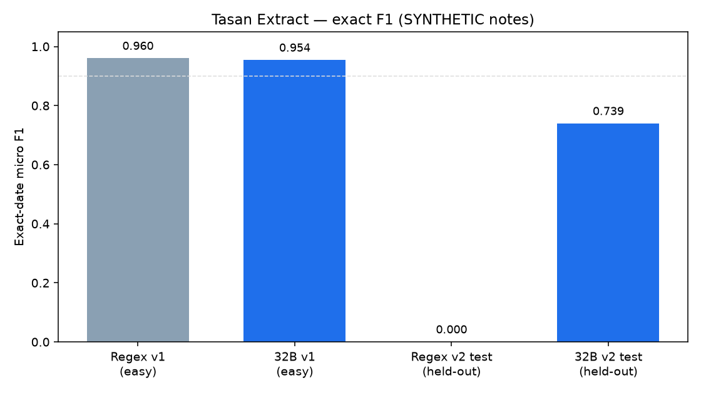
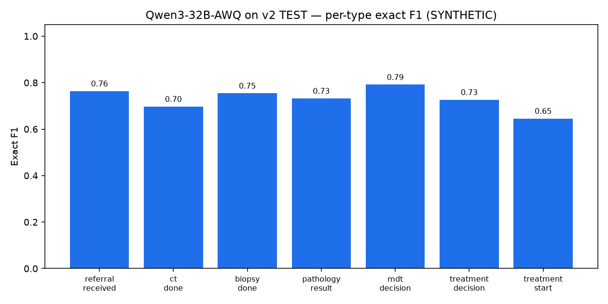
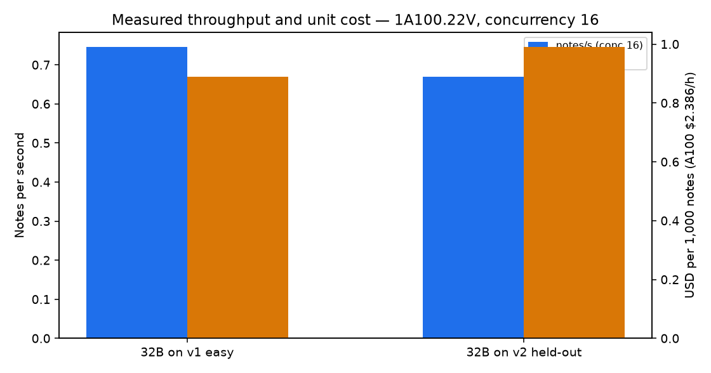

# Tasan Extract — results (SYNTHETIC eval)

**SYNTHETIC DOCUMENT — NOT A REAL PATIENT.** All notes, names and dates are invented. No real EHR text was used.

Measured on a Verda **1A100.22V** on-demand instance in **FIN-01** (`e60ea3d7…`, $2.386/h), Qwen3-32B-AWQ served with vLLM, thinking off, OpenAI `json_schema`, concurrency 16. Instance deleted 22:35 EET on 14 Nov 2026 after the 32B extracts (see `data/SPEND.md` §8).

Still outstanding on a later GPU slot: paraphrase pass, Qwen3-8B extract, concurrency 1/8/32/64 sweep, LoRA. The 32B numbers below are the current best model.

## Scores

| System | Split | Docs | Exact P / R / F1 | ±1 day F1 | Day-28 alert acc (P / R / F1) |
|---|---|---:|---|---:|---|
| Regex (v1-tuned) | v1 all | 600 | 0.976 / 0.944 / **0.960** | — | (see regex report) |
| **Qwen3-32B-AWQ** | v1 all | 600 | 0.955 / 0.953 / **0.954** | **0.964** | 0.983 (1.000 / 0.938 / 0.968) |
| Regex (untuned) | v2 dev | 199 | 0.000 / 0.000 / **0.000** | 0.000 | 0.775 (0 / 0 / 0) |
| Regex (untuned) | v2 test | 401 | 0.000 / 0.000 / **0.000** | 0.000 | 0.812 (0 / 0 / 0) |
| **Qwen3-32B-AWQ** | v2 all | 600 | 0.765 / 0.720 / **0.742** | **0.763** | 0.958 (0.913 / 0.875 / 0.894) |
| **Qwen3-32B-AWQ** | v2 dev | 199 | 0.765 / 0.730 / **0.747** | **0.766** | 0.950 (1.000 / 0.778 / 0.875) |
| **Qwen3-32B-AWQ** | v2 test | 401 | 0.765 / 0.715 / **0.739** | **0.761** | 0.963 (0.875 / 0.933 / 0.903) |

v2 gold dates are recoverable by a careful human (spelled months, ISO weeks, relatives against `note_date`); the regex F1 of 0.000 is held-out keywords **plus** date formats the v1 parser was never taught (`dd-mm-yyyy`, `14. huhtikuuta 2026`, `viikolla 34 maanantaina (2026)`). Details in `eval/results/v2_date_sanity.md`. Every v2 body contains at least one literal date string (often a historical distractor in dotted `d.m.yyyy`); most gold event spans also carry a spelled, week, or dashed date.

### v2 test per-type exact F1 (32B)

| type | F1 |
|---|---:|
| referral_received | 0.764 |
| ct_done | 0.697 |
| biopsy_done | 0.754 |
| pathology_result | 0.732 |
| mdt_decision | 0.791 |
| treatment_decision | 0.726 |
| treatment_start | 0.646 |

## Throughput and unit cost (measured)

Only **concurrency 16** was measured on this instance (the 1/8/32/64 sweep did not run before teardown).

| Model | Corpus | Conc. | Notes/s | Latency p50 / p95 (s) | $ / 1,000 notes at $2.386/h |
|---|---|---:|---:|---|---:|
| Qwen3-32B-AWQ | v1 | 16 | **0.746** | 18.2 / 40.7 | **$0.89** |
| Qwen3-32B-AWQ | v2 | 16 | **0.669** | 20.5 / 45.8 | **$0.99** |

GPU-hours for 1,000 notes ≈ 1 / (notes/s × 3600): **0.37 h** (v1) and **0.42 h** (v2).

## Nationwide yearly sketch (labelled assumptions)

- **Patients / year:** **2,994** new lung and tracheal cancers per year in Finland, the 2020–2024 average from the Finnish Cancer Registry (1,780 men + 1,214 women). Source: [Lung, trachea fact sheet](https://syoparekisteri.fi/assets/themes/ssy3/factsheets/syopien-tietolaatikot/22en_Lung.html) and [Cancer in Finland 2024](https://syoparekisteri.fi/assets/themes/ssy3/factsheets/cancer_in_finland_2024.html). Preliminary 2024 count is similar (1,717 + 1,175 = 2,892).
- **Notes / patient:** **5** pathway documents, equal to the mean length of our SYNTHETIC corpora (600 docs / 120 patients). This is an **assumption for costing**, not a published clinical figure.
- **Volume:** 2,994 × 5 = **14,970 notes / year** nationwide.

| Serving assumption | Unit cost | Implied nationwide / year |
|---|---:|---:|
| 32B on A100, conc 16, v2-like notes ($0.99 / 1k) | $0.99 / 1k | **≈ $15** |
| Same, v1-like notes ($0.89 / 1k) | $0.89 / 1k | **≈ $13** |

These are GPU list-price sketches for extraction only (no engineer time, no HA, no idle). An 8B or LoRA 8B figure should replace the 32B row once that sweep exists. Even the 32B number is small relative to the Extract GPU cap.

## Spend (this run)

See `../../data/SPEND.md` §8. Preferred actual (life minutes, unused 10-minute increment refunded): **≈ $3.77**, of which two aborted RTX boots ≈ $0.17 and the A100 (including ≈ 48 min idle after 21:47) ≈ $3.60. Increment-grossed alternative ≈ $4.62.

## Deletion

`e60ea3d7-a593-4c34-b208-64cfec0eb8c4` was API-deleted at 22:35:03 EET with OS volume `3300c6fa…`. Verified: instance **discontinued** and absent from `GET /instances`; volume `status=deleted`, absent from `GET /volumes` and `GET /volumes/trash`. Extract SSH key had already been removed by a teammate; `tasan-ask-ephemeral` was left untouched.
